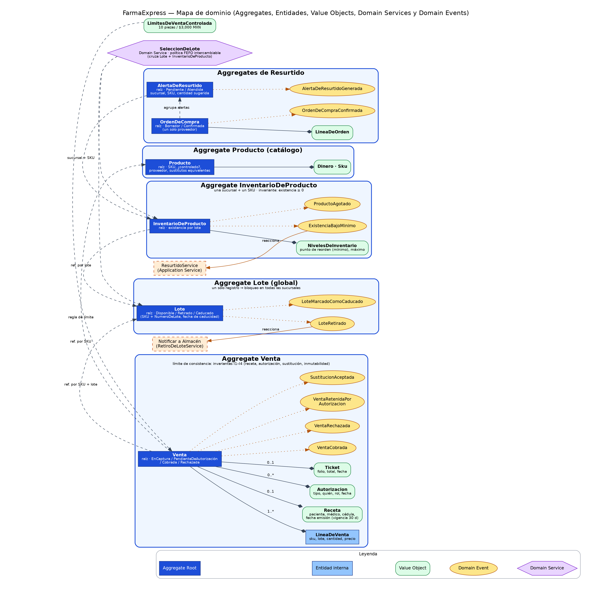
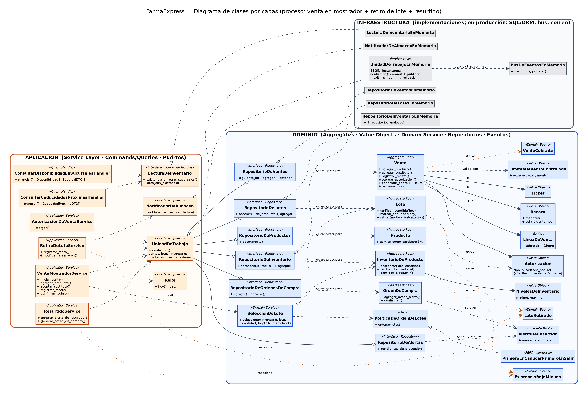
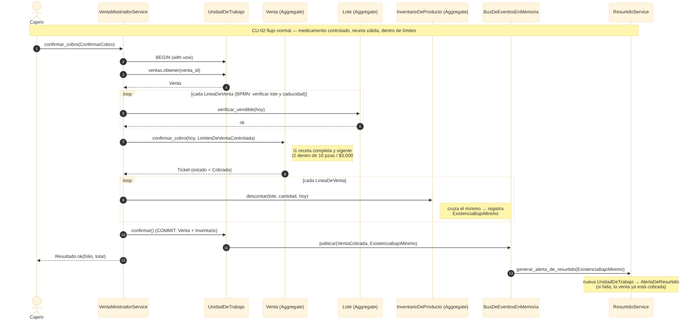
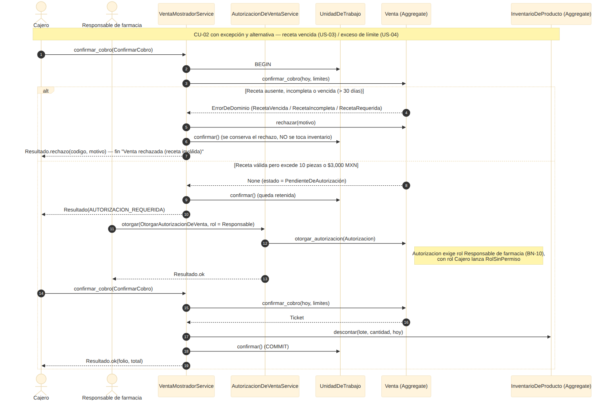

# FarmaExpress — Unidad 3: Diseño arquitectural del sistema

**Curso:** Componentes de Lógica de Negocios · **Equipo 10** · FIME-UANL
**Integrantes:** Arleth García Martínez (2145524) · Ángel Mauricio Castruita Márquez (2146281) · Carlos Patricio Lozano Treviño (2147049)
**Empresa y caso:** FarmaExpress (continuación de la Unidad 2). **Proceso principal:** venta en mostrador con validación de receta, existencia, lote y caducidad, y disparo de resurtido.

## Entregables de la actividad "Diseño Arquitectural del Sistema"
| # | Lo que pide la actividad | Dónde se cumple |
|---|---|---|
| 01 | **Elegir patrones:** tabla comparativa (Transaction Script, Table Module, Active Record, Domain Model) y justificación | [`docs/01-seleccion-de-patron.md`](docs/01-seleccion-de-patron.md) · [ADR-001](docs/adr/ADR-001-domain-model-como-patron-principal.md) |
| 02 | **Mapa de dominio:** Aggregates, Entidades, Value Objects, Domain Events, diagrama con relaciones y lenguaje ubicuo | [`docs/02-mapa-de-dominio.md`](docs/02-mapa-de-dominio.md) · [diagrama](diagrams/01-mapa-de-dominio.png) |
| 03 | **Service Layer:** Application Services, un método por caso de uso, sólo coordinación | [`docs/03-service-layer-persistencia-cqrs.md`](docs/03-service-layer-persistencia-cqrs.md) · [`src/farmaexpress/aplicacion/servicios.py`](src/farmaexpress/aplicacion/servicios.py) |
| 04 | **Diagramas UML + ADR:** diagrama de clases completo, 2 diagramas de secuencia de los flujos más complejos y ADR | [clases](diagrams/02-diagrama-de-clases.png) · [secuencia 1](diagrams/03-secuencia-cobro-controlado.png) · [secuencia 2](diagrams/04-secuencia-receta-vencida-y-autorizacion.png) · [ADR-001…005](docs/adr/README.md) |

## Diagramas

### Mapa de dominio (DDD)


### Diagrama de clases (por capas)


### Secuencia 1 — Cobro de medicamento controlado (flujo normal + resurtido por evento)


### Secuencia 2 — Receta vencida (rechazo) y exceso de límite (autorización del Responsable)


## Índice completo del repositorio
| Entregable | Ubicación |
|---|---|
| Casos de uso (Etapa 1) | `docs/00-casos-de-uso.md` |
| Selección de patrón (Etapa 2) | `docs/01-seleccion-de-patron.md` |
| Mapa de dominio / DDD (Etapa 3) | `docs/02-mapa-de-dominio.md` · `diagrams/01-mapa-de-dominio.{dot,svg,png}` |
| Service Layer, Repository, Unit of Work, CQRS (Etapas 4–6) | `docs/03-service-layer-persistencia-cqrs.md` |
| Revisión SOLID (Etapa 7) | `docs/04-revision-solid.md` |
| **Diagrama de clases** | `diagrams/02-diagrama-de-clases.{dot,svg,png}` |
| **Diagramas de secuencia** | `diagrams/03-secuencia-cobro-controlado.{mmd,png}` · `diagrams/04-secuencia-receta-vencida-y-autorizacion.{mmd,png}` |
| **ADR** | `docs/adr/ADR-001…ADR-005` (índice en `docs/adr/README.md`) |
| Matriz de trazabilidad | `docs/05-trazabilidad.md` |
| **Validación de la propuesta (Etapa 9)** | `docs/08-validacion-de-propuesta.md` |
| Hallazgos sobre la U2 | `docs/06-hallazgos-u2.md` |
| Bitácora de IA | `docs/07-bitacora-ia.md` |
| Código base | `src/farmaexpress/{dominio,aplicacion,infraestructura}` |
| Pruebas | `tests/` |

## Cómo revisar
```bash
pip install -r requirements-dev.txt
python -m pytest -q          # 21 pruebas: casos de uso + reglas de arquitectura
```
Regenerar diagramas (opcional): `dot -Tpng -Gdpi=150 diagrams/01-mapa-de-dominio.dot -o diagrams/01-mapa-de-dominio.png` (Graphviz) y `mmdc -i diagrams/03-secuencia-cobro-controlado.mmd -o diagrams/03-secuencia-cobro-controlado.png` (Mermaid CLI).

## Estructura
```
docs/        informe por etapas, ADR, trazabilidad, hallazgos, bitácora de IA
diagrams/    fuentes (.dot, .mmd) y exportaciones (.png, .svg)
src/         dominio (reglas) · aplicacion (casos de uso, puertos) · infraestructura (implementaciones en memoria)
tests/       un escenario por caso de uso + pruebas de dependencias entre capas
```
La regla de dependencia es `infraestructura → aplicacion → dominio`, verificada automáticamente en `tests/test_arquitectura.py`.

## Supuestos pendientes de validar
FEFO como política de lote, vigencia de receta de 30 días, "sucursales cercanas" = todas las demás, `Receta` como Value Object. Ver `docs/06-hallazgos-u2.md`.
